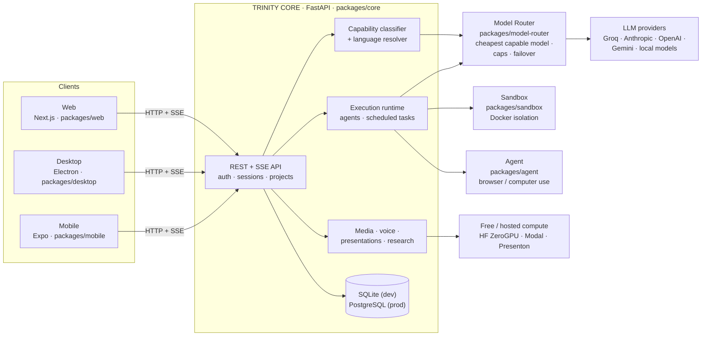

<div align="center">


# TRINDATRON

### The open-source AI workspace that speaks your language and fits your budget.

**Chat · research · agents · code · slides · images · video · voice**,
answering natively in **Português, Español and English**, routed to the cheapest
model that can actually do the job.

[](LICENSE)
[](https://github.com/diegotrindademt/trindatron/actions/workflows/ci.yml)
[](#run-the-tests)
[](packages/core/src/language.py)
[](CONTRIBUTING.md)

[Quickstart](#-quickstart-5-minutes) · [Features](#-what-it-can-do) · [How it works](#-how-it-works) · [Contribute](#-contributing) · [Roadmap](#-roadmap)

<br>


<sub>A real session (time-lapse): <i>"On the web, open the Wikipedia page about Lisbon and build me a 3-day itinerary."</i> It browses, reads and brings back the plan.</sub>

</div>

---

## 💡 Why TRINDATRON exists

The best AI tools are designed in English, priced in dollars and tuned for people
who can pay US$20+ a month. More than **800 million people speak Portuguese or
Spanish**, and they get translated menus and answers that slowly drift back
into English.

TRINDATRON flips that around:

- 🗣️ **Your language comes first.** It doesn't translate after the fact. The
  answer language follows *your choice*, then *your device*, then *your text*,
  in that order of evidence ([`language.py`](packages/core/src/language.py)). Ask in
  Portuguese, get Portuguese. Every time.
- 💸 **Cheap by design.** Every request goes to the **cheapest model that is
  actually capable of it**. It doesn't run down a fixed fallback list: it scores
  complexity, applies quality floors and per-plan cost caps, and fails over when
  a provider is down ([how the router works](docs/ADAPTIVE_INTELLIGENCE_ROUTER.md)).
- 🆓 **Free compute first.** Free tiers (Groq, Hugging Face ZeroGPU Spaces, local
  models) are used before paid ones wherever quality allows. **A free Groq key
  is enough to run the whole thing.**
- 🔓 **Yours to run.** Self-host it, read every line, change anything. AGPL-3.0.

## ✨ What it can do

<div align="center">

<sub>Product previews from the TRINDATRON site: code, its own isolated computer, presentations.</sub>
</div>

| | |
|---|---|
| 💬 **Streaming chat** | Real-time answers over Server-Sent Events, with projects, memories and reusable skills |
| 🌐 **Web research & browsing** | Searches, opens pages and answers with sources |
| 🤖 **Agents that act** | A browser / computer-use agent working inside an isolated desktop sandbox, with approval steps for sensitive actions |
| 🧑‍💻 **Code that runs** | Executes code in a locked-down Docker sandbox (memory, CPU and process limits) |
| ⏰ **Persistent agents** | Agents you define once and schedule to run on their own |
| 📊 **Presentations** | Turns notes into slide decks (PPTX / PDF) |
| 🎨 **Images & video** | Image generation, video generation and editing, with free and hosted engines |
| 🎙️ **Voice** | Read-aloud (TTS) and voice input (STT) |
| 📄 **Files** | Reads PDFs and attachments |
| 👥 **Accounts & teams** | Email/password and Google sign-in, sessions, account recovery, team seats, admin metrics |
| 🖥️ **Everywhere** | Web app (Next.js), desktop app (Electron) and mobile app (Expo: Android, iPhone, iPad) |

## 🧠 How it works

Every message goes through a short pipeline before any model is called:

```
your message
  → capability     what kind of job is this? (chat, research, agent, media…)
  → language       pt / es / en, from your choice → device → text
  → complexity     cheap heuristics, no LLM call
  → quality floor  max(complexity floor, plan floor), which can only go up, never down
  → candidates     models that can really do it (tools, context window, modality)
  → cost ranking   cheapest capable model first
  → limits         plan token and cost caps, failover budget
  → health         circuit breakers skip providers that are failing
  → answer         streamed back, and recovered automatically if it comes back unusable
```



| Package | Stack | What it does |
|---|---|---|
| [`packages/core`](packages/core) | Python 3.12 · FastAPI · SQLAlchemy · Alembic | Main API: auth, chat streaming, projects, agents, media, migrations |
| [`packages/model-router`](packages/model-router) | Python · LiteLLM | Model selection, cost accounting, plan limits, circuit breakers, failover |
| [`packages/sandbox`](packages/sandbox) | Python · Docker | Isolated shell, code and desktop execution |
| [`packages/agent`](packages/agent) | Python · Playwright | Agentic browser / computer-use layer with a permission manifest |
| [`packages/web`](packages/web) | TypeScript · Next.js 15 · Tailwind | Web interface in pt / en / es |
| [`packages/desktop`](packages/desktop) | TypeScript · Electron | Desktop app |
| [`packages/mobile`](packages/mobile) | TypeScript · Expo SDK 57 · React Native | Mobile app for Android, iPhone, iPad (and Web) |
| [`infra/`](infra) | Modal · Presenton | Optional workers for video and presentations |

Built to be trusted: **5,400+ automated tests** (backend, router, agent, web
and mobile), security tests for auth, object-level authorization and SSRF, and a
PostgreSQL concurrency suite in CI.

Go deeper: [execution runtime](docs/EXECUTION_RUNTIME.md) ·
[persistent agents](docs/PERSISTENT_AGENTS.md) ·
[media engines](docs/MEDIA_ENGINES.md) ·
[free compute pool](docs/FREE_COMPUTE_POOL.md) ·
[local AI lab](docs/LOCAL_AI_LAB.md) ·
[mobile app](docs/MOBILE.md) (pt-BR) ·
[architecture decisions](docs/architecture/decisions)

---

## 🚀 Quickstart (5 minutes)

**You need:** Python 3.12+, [uv](https://docs.astral.sh/uv/), Node.js 22+, and
one LLM key. The cheapest path is a **free Groq key**:
<https://console.groq.com/keys>.

### 1. Backend

> **Windows:** clone into a short path such as `C:\src`: a dependency's
> tokenizer cache can exceed the 260-character path limit in deep folders.

```bash
git clone https://github.com/diegotrindademt/trindatron.git
cd trindatron/packages/core

uv sync
cp .env.example .env          # Windows PowerShell: copy .env.example .env
```

Open `packages/core/.env` and set **one** provider key, for example:

```dotenv
GROQ_API_KEY=gsk_your_key_here
ANTHROPIC_API_KEY=
OPENAI_API_KEY=
```

(Clear the `sk-...` placeholders of providers you don't use.) Then:

```bash
uv run alembic upgrade head   # creates the local SQLite database
uv run uvicorn src.main:app --reload --port 8000
```

Check it: <http://localhost:8000/health> returns `{"status": "ok", ...}` and the
interactive API docs live at <http://localhost:8000/docs>.

### 2. Web app

In a second terminal, from the repository root:

```bash
npm install
npm run dev:web
```

Open <http://localhost:3000>, create an account and start chatting. 🎉
The web app talks to `http://localhost:8000` by default (override it with
`NEXT_PUBLIC_API_URL` in `packages/web/.env.local`).

### 3. Mobile app (optional)

The mobile app is a standalone npm project:

```bash
cd packages/mobile
npm install
cp .env.example .env          # EXPO_PUBLIC_API_URL (Android emulator: http://10.0.2.2:8000)
npm run web                   # or: npm run android / npm run ios
```

### Run the tests

```bash
cd packages/core && uv run pytest -q              # backend (SQLite)
cd packages/model-router && uv run pytest -q      # router
cd packages/agent && uv run pytest -q             # agent
cd packages/web && npm run typecheck && npm test  # web
cd packages/mobile && npm run typecheck && npm test  # mobile
```

Tests that need PostgreSQL are skipped unless `TEST_POSTGRES_URL` is set. CI
runs them against a real PostgreSQL service.

## ⚙️ Configuration

All backend settings live in [`packages/core/.env.example`](packages/core/.env.example).
Its comments are in Portuguese for now, and translating them is a
[good first issue](../../issues?q=is%3Aissue+is%3Aopen+label%3A%22good+first+issue%22).
Every integration (media providers, payments, email, Google sign-in) is **off by
default** and switches on only when you add its keys.

Going to production? The backend refuses to start unless `DATABASE_URL` points
to PostgreSQL, `JWT_SECRET_KEY` is a real secret (32+ characters), `DEBUG=false`
and `ALLOWED_ORIGINS` has no localhost entries.

## 🗺️ Roadmap

- [x] 📱 Mobile app (Expo / React Native)
- [ ] 📄 Documents: reports and contracts as PDF / DOCX
- [ ] 🐳 One-command `docker compose up`
- [ ] 🌎 English translations of code comments and docs
- [ ] 🧪 More Spanish coverage in prompts and tests
- [ ] 🔌 More free and local model backends

Have an idea? [Open a feature request](../../issues/new/choose).

## 🤝 Contributing

Anyone can help, whether you write Python, TypeScript, docs or translations.

1. **Fork** the repository and create a branch.
2. Make your change **with tests** (see [CONTRIBUTING.md](CONTRIBUTING.md)).
3. Open a **pull request**. CI runs every test automatically.
4. The maintainer reviews it, suggests changes if needed, and merges it. 🎉

New here? Start with an issue labelled
[`good first issue`](../../issues?q=is%3Aissue+is%3Aopen+label%3A%22good+first+issue%22).
Please read the [Code of Conduct](CODE_OF_CONDUCT.md). Found a security problem?
Report it privately through [SECURITY.md](SECURITY.md), never in a public issue.

## ⭐ Like it?

If you believe AI should speak your language and fit your budget, **give the
project a star**. It helps other Portuguese and Spanish speakers find it, and it
keeps the project going.

## 👤 Author

Built in the open by **Diego Trindade** ([@diegotrindademt](https://github.com/diegotrindademt)),
a self-taught developer from Brazil.

## 📜 License

TRINDATRON is licensed under the **GNU Affero General Public License v3.0**
([LICENSE](LICENSE)). You can use, study, change and share it. If you run a
modified version as a network service, you must make your source code available
to its users.

Copyright © 2026 Diego Trindade.
